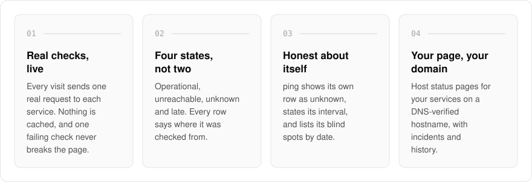
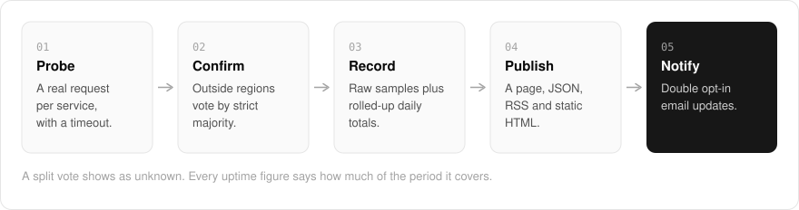

  <picture>
    <source media="(prefers-color-scheme: dark)" srcset=".github/assets/hero-dark.png">
    
  </picture>

<h1 align="center">ping.me.at</h1>

<strong>A status page that only reports what it saw.</strong>

  
  
  
  

  <a href="#features">Features</a> ·
  <a href="#how-it-works">How it works</a> ·
  <a href="#screenshots">Screenshots</a> ·
  <a href="#built-with">Built with</a>

Most status pages stay green until someone remembers to change them. I built ping.me.at so the page is the measurement: it checks each service with a real request and shows the result live, and when it cannot tell, it says **unknown** instead of guessing. Sign in and host status pages for your own services, publish incidents on your own domain, and keep a public history your users can trust. It also runs the network status board for the `*.me.at` family.

  <picture>
    <source media="(prefers-color-scheme: dark)" srcset=".github/assets/overview-dark.svg">
    
  </picture>

## Why ping.me.at

| The usual status page | ping.me.at |
| --- | --- |
| Shows what someone last typed in | Shows what a real request just saw |
| Up or down | Operational, unreachable, unknown or late |
| Hides its own gaps | Lists its blind spots, with dates |
| "99.99% uptime" with no denominator | Every figure says how much of the period it covers |

## Features

- **Live, uncached checks**: every visit sends one real request to each service, with a timeout, and a failing check cannot break the rest of the page.
- **Four states, not two**: operational, unreachable, unknown and late, with every row labelled with where it was checked from.
- **Honest about itself**: ping shows its own row as unknown, states its check interval, and keeps a dated list of its blind spots on the board.
- **Scheduled checks with bounded history**: a scheduled prober keeps raw samples and rolled-up daily totals, and every uptime figure shows how much of the period it covers.
- **A second view from outside**: regional readings from outside the network are combined by strict majority, and a split shows as unknown.
- **Hosted status pages**: public or private pages at their own address, on a custom hostname verified by DNS record, each with its own monitors, history and incidents.
- **Heartbeats and scripted browser checks**: scheduled jobs check in to their own URL (a missed check-in shows as late), and short browser scripts run on a schedule against a runner you provide.
- **Double opt-in email updates and open formats**: subscribers confirm before anything is sent, and the status document is also served as JSON, RSS and static HTML.

## How it works

  <picture>
    <source media="(prefers-color-scheme: dark)" srcset=".github/assets/flow-dark.svg">
    
  </picture>

A check is one real request with a timeout. Readings from outside the network are combined by strict majority, so a split vote becomes unknown rather than a guess. Samples are kept raw and rolled up into daily totals, then published as a page, JSON, RSS and static HTML, with email going only to subscribers who confirmed.

## Screenshots

<table>
  <tr>
    <td width="50%"><picture><source media="(prefers-color-scheme: dark)" srcset=".github/assets/hero-dark.png"></picture> The landing page: what ping checks and how it reports.</td>
    <td width="50%"><picture><source media="(prefers-color-scheme: dark)" srcset=".github/assets/pricing-dark.png"></picture> Pricing: the free and Pro plans for hosted status pages, and how a self-hosted instance is licensed.</td>
  </tr>
</table>

## Built with

  
  
  
  
  
  

- Next.js 16 (App Router), React 19, TypeScript
- Tailwind CSS 4
- Drizzle ORM + Postgres
- Better Auth
- oRPC
- Cloudflare Workers via OpenNext (`@opennextjs/cloudflare`)
- Resend for subscriber email

## Part of the me.at family

ping.me.at is one of my [`*.me.at`](https://me.at) apps. They share one design system, one account, and one app shell. Development happens in a private monorepo; this repository is the project's public-facing home.

## License

Source-available. See [LICENSE](LICENSE).
