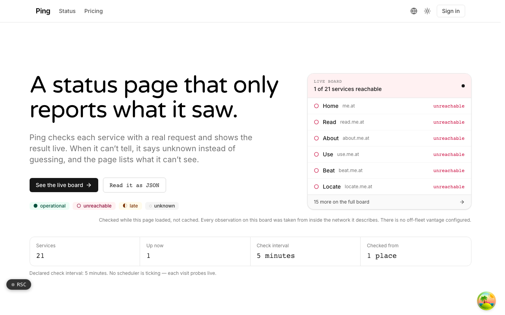
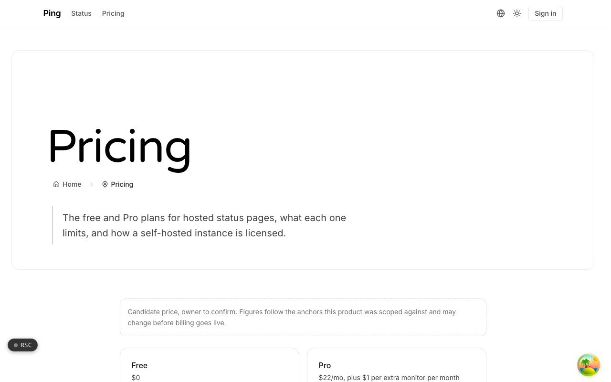

  <picture>
    <source media="(prefers-color-scheme: dark)" srcset=".github/assets/hero-dark.png">
    
  </picture>

# ping.me.at

A status page that only reports what it saw.

ping.me.at is a hosted status-page product backed by real uptime checks. It checks each service with a real request and shows the result live; when it cannot tell, it says unknown instead of guessing, and the page lists what it cannot see. Signed-in accounts can host status pages for their own services, publish incidents on their own domain, and keep a public history their users can trust. It also runs the network status board for the `*.me.at` family.

## Features

- **Live, uncached checks**: every visit sends one real request to each service, with a timeout, and a failing check cannot break the rest of the page.
- **Four states, not two**: operational, unreachable, unknown and late, with every row labelled with where it was checked from.
- **Honest about itself**: ping shows its own row as unknown, states its check interval, and keeps a dated list of its blind spots on the board.
- **Scheduled checks with bounded history**: a scheduled prober keeps raw samples and rolled-up daily totals, and every uptime figure shows how much of the period it covers.
- **A second view from outside**: regional readings from outside the network are combined by strict majority, and a split shows as unknown.
- **Hosted status pages**: public or private pages at their own address, on a custom hostname verified by DNS record, each with its own monitors, history and incidents.
- **Heartbeats and scripted browser checks**: scheduled jobs check in to their own URL (a missed check-in shows as late), and short browser scripts run on a schedule against a runner you provide.
- **Double opt-in email updates and open formats**: subscribers confirm before anything is sent, and the status document is also served as JSON, RSS and static HTML.

## Screenshots

<table>
  <tr>
    <td width="50%"><picture><source media="(prefers-color-scheme: dark)" srcset=".github/assets/pricing-dark.png"></picture> Pricing: the free and Pro plans for hosted status pages, and how a self-hosted instance is licensed.</td>
  </tr>
</table>

## Built with

- Next.js 16 (App Router), React 19, TypeScript
- Tailwind CSS 4
- Drizzle ORM + Postgres
- Better Auth
- oRPC
- Cloudflare Workers via OpenNext (`@opennextjs/cloudflare`)
- Resend for subscriber email

## Part of the me.at family

ping.me.at is one of the [`*.me.at`](https://me.at) apps by Trevor McDougald. They share one design system, account, and app shell. Development happens in a private monorepo; this repository is the project's public-facing home.

## License

See [LICENSE](LICENSE).
